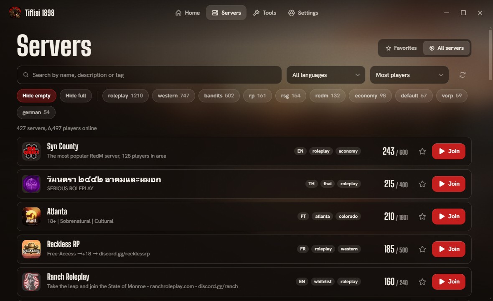
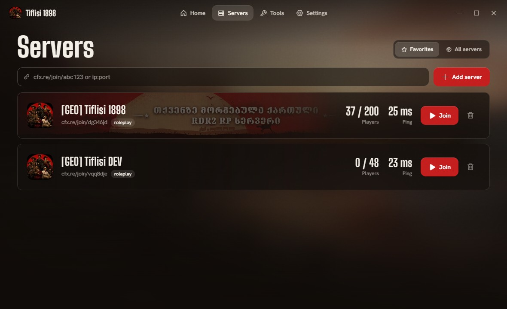
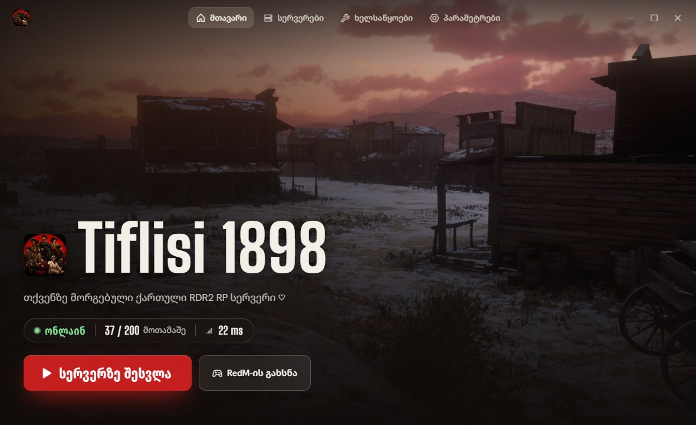

# Open RedM Launcher

A free, open-source launcher for RedM servers. One server is featured on the home page (yours), and players can still browse and join any other server. It also fixes the usual player problems: wrong client branch, broken caches, the game running on the wrong GPU.


## Screenshots

| | |
|---|---|
|  |  |
| **All servers**: every public RedM server, with search, language and tag filters. | **Favorites**: your saved servers with live players and ping. |
|  |  |
| **Tools**: switch the client branch and clean caches, with live sizes. | **Graphics and performance**: high-performance GPU, fullscreen optimizations, priority. |
|  |  |
| **Settings**: one-click updates, privacy switch, source code link. | **31 languages**. English and Georgian cover every screen; the others fall back to English for the newest ones. |

Shown with the [Tiflisi 1898](https://cfx.re/join/dg346jd) branding. Every name, color, logo and background comes from `config.json`.

## Features

- **Featured server**: live status, players, your own ping, one-click join.
- **Ready to play**: one line under Join says "Ready to play" or how many things need fixing (RedM installed, game found, join links working, right game version, fast graphics card, free disk space). Every problem has a Fix button.
- **Fix my game**: one button that closes RedM, clears the server and RedM caches and applies the recommended settings, with a plain list of what it did.
- **Crash helper**: when RedM crashes, the launcher reads RedM's log, explains the likely cause in plain words and offers "Copy report for staff".
- **Alerts and auto-join**: a Windows notification when the server is back online; on a full server, Join waits and joins as soon as a slot opens.
- **Servers tab**:
  - Favorites: add any server by `cfx.re/join/xxxx` or `ip:port`, with its Cfx banner, icon, players and ping.
  - All servers: every public RedM server from the Cfx list, with search, language, tag, hide empty/full and sort filters.
- **Tools tab** (fixes for the usual player problems):
  - Switch the client branch (production / beta / canary / your own presets / custom). It edits `CitizenFX.ini` and keeps a `.bak` copy.
  - Clean up, with live sizes: server cache, RedM app cache, GPU shader cache, crash dumps, old logs, in-game UI storage, Windows temp (older than 2 days). The sign-in session and the newest logs are kept.
  - Graphics and performance: use the high-performance GPU, turn off fullscreen optimizations (both per-app Windows settings, reversible), high priority while playing, and reset graphics settings (keeps a backup).
  - Restart or force-close RedM, open the logs and crashes folders.
- **Launcher-join detection**: the `server-resource/launcher_check` resource tells you who joined through the launcher, and can require it.
- **Discord Rich Presence**: set `discordClientId` to show "Playing on <server>" (no extra dependency).
- News, devlog and rules, either from `config.json` or from an optional panel API. Gallery and staff pages need the API.
- 30+ UI languages.

## Make it yours

Out of the box this is the [Tiflisi 1898](https://cfx.re/join/dg346jd) launcher: its logo, colors and server. To build one for your own server, replace `assets/icon.png` (512×512 PNG) and edit `config.json`:

| Key | What it does |
|---|---|
| `brand.name`, `brand.logo`, `brand.background`, `brand.*Color`, `brand.welcomeMessage` | Look and feel |
| `brand.cfxCode` | Featured server (`abc123` or `ip:port`) |
| `servers` | Default entries for the Servers tab: `[{ "name": "", "address": "cfx.re/join/abc123" }]` |
| `branches` | Extra branch buttons in Tools: `[{ "label": "128", "channel": "specific/feature/..." }]` |
| `recommendedBranch` | The game version your server needs. Players on another one get a "Switch" fix and a prompt before joining. Leave empty if any version works. |
| `news`, `changelogs`, `rules` | Static content when you don't run an API |
| `apiUrl`, `slug` | Optional panel API (`GET {apiUrl}/{slug}`, `/gallery`, `/staff`) |
| `defaultLanguage` | e.g. `en`, `ka`, `de` |
| `discordClientId` | Discord application id for Rich Presence |
| `usageStats` | `false` turns the anonymous usage heartbeat off for everyone |
| `sourceUrl` | Link behind "Source code" in Settings (defaults to this repository) |

`brand.backgrounds` is a list of images (`../../assets/...` paths or https URLs) that rotate behind Home. Leave it empty and the launcher uses your panel's gallery, then your server's Cfx banner. `brand.logo` and `brand.welcomeMessage` fall back to the icon and description you set on Cfx.

To keep your own server's settings out of git, put them in `config.local.json` (git-ignored). It is merged over `config.json` when you run the launcher locally. It is not included in builds.

## Run / build

```
npm install
npm start
npm run build:win   # installer in dist/
```

Self-checks (no test framework needed):

```
node test/server-list.check.js   # add --live to hit the real Cfx list
node test/cleanup.check.js
node test/graphics.check.js
node test/launcher_check.check.js   # runs the server resource in a Lua VM
```

Or all at once: `npm test`.

## Updates

Installed launchers check your GitHub releases at start, every 10 minutes, and when the window comes back to the front. A new version downloads in the background (only the changed parts), then a small "Update to x.y.z" button appears in the title bar. One click restarts into the new version in a few seconds, with no installer window. If nobody clicks, it installs the next time the launcher closes.

To release: bump `version` in `package.json`, then push a tag:

```
git tag v1.1.0
git push --tags
```

The `Release` GitHub Action builds the installer, uploads it to a draft release, and publishes the release once every file is uploaded. If a player reports update trouble, ask for `%APPDATA%\open-redm-launcher\updater.log`. Point `build.publish` in `package.json` at your own repository if you fork this.

Unsigned builds show Windows SmartScreen's "unknown publisher" warning on first install. Add a code-signing certificate as the `CSC_LINK` and `CSC_KEY_PASSWORD` repository secrets to remove it.

## Live usage dashboard

With `launcher_check` running (below), launchers send an anonymous heartbeat to your featured server every minute: a random install id, launcher version, UI language and whether the game is running. No names, no files, no hardware info. Players can switch it off in Settings, and `"usageStats": false` in `config.json` turns the feature off entirely.

Set a password and open the dashboard:

```
set launcher_check_dashboard_password "a-long-unique-password"
```

`http://<server-ip>:<port>/launcher_check/dashboard` (user `admin`). It shows, live: launchers open and how many of them are in game, players who joined with and without the launcher, launcher versions and languages. FXServer serves it over plain HTTP, so use a password you don't use anywhere else. The `launcherstats` console command prints the same numbers.

## Privacy and security

- The launcher never sends anything anywhere except: the Cfx server list, your configured servers, your panel API (if set), GitHub (update checks) and, if enabled, the anonymous heartbeat above.
- The window is locked down: sandboxed renderer, no Node access, a strict Content-Security-Policy (only the launcher's own scripts run, so server names or news text can never execute code), no pop-ups, no navigating away.
- Cleanup only empties known cache folders, keeps your sign-in session, and asks before deleting. Graphics switches use Windows' own per-app settings and can be turned off again.
- `apiUrl` must be `https`.

## Launcher-join detection (server side)

Copy `server-resource/launcher_check` into your server's resources folder and `ensure launcher_check`. Right before connecting, the launcher sends `POST http://<server>/launcher_check/hello`. The resource matches that IP when the player connects.

```
set launcher_check_mode "log"      # or "require" to refuse non-launcher joins
set launcher_check_url  "https://your-site/download"
```

- `exports.launcher_check:UsedLauncher(src)` returns `true/false, version`
- `exports.launcher_check:ClaimOnce(src, "my_reward")` returns `true` only the first time a Rockstar license claims that reward while using the launcher, for one-time rewards
- the server event `launcher_check:joined` (`src`, `version`) fires when a launcher player joins
- the state bag `Player(src).state.viaLauncher` holds the same answer
- the console command `launcherstats` shows the counts

### Reward launcher players (VORP)

`server-resource/launcher_reward_vorp` pays a one-time money bonus, once per Rockstar license (not per character), when a launcher player's character loads, with an in-game message. `ensure` it after `launcher_check` and `vorp_core`:

```
set launcher_reward_money 10
set launcher_reward_message "Thanks for playing with the launcher! +$%s"
```

Keep rewards modest: the join signal can be imitated by someone who reads this code.

Limits: matching is by IP, so players behind the same NAT share a hello. It also only works when the server's real `ip:port` is public (not hidden behind a Cfx proxy).

## License

MIT
