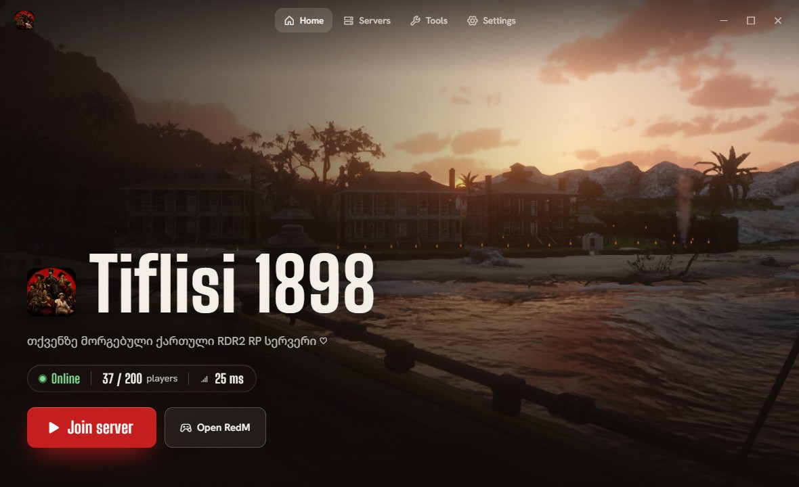
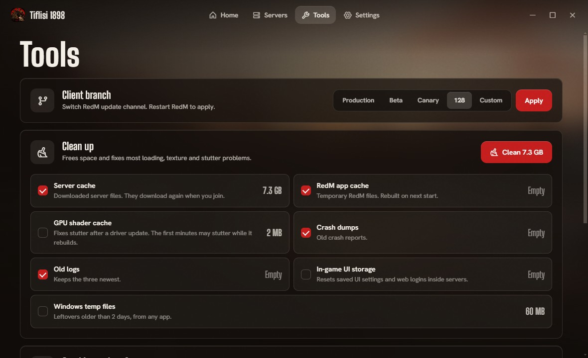
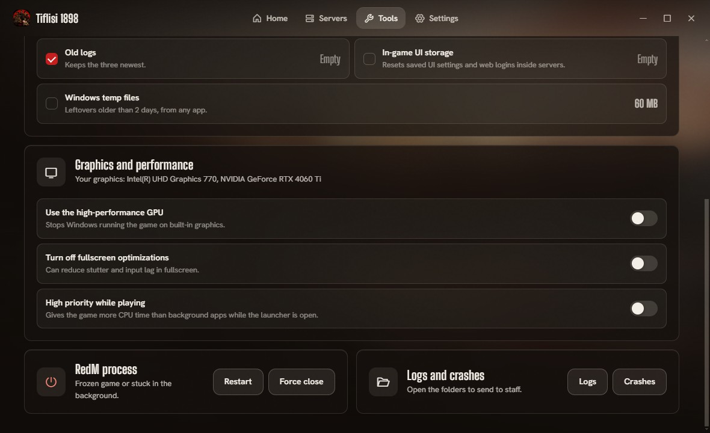
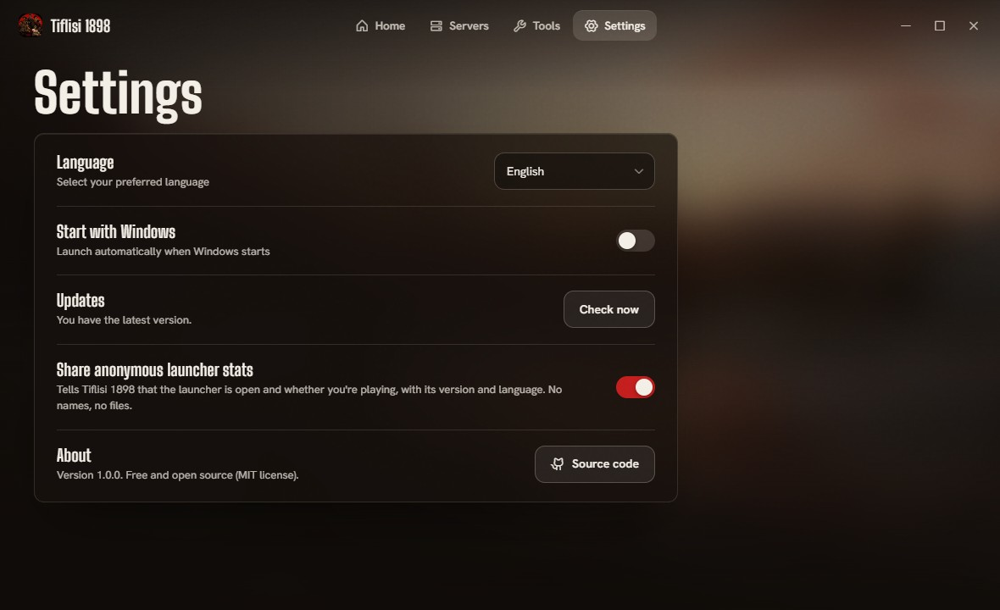

# Tiflisi Launcher

A free, open-source launcher for one RedM server: yours. Players join in one click, and it fixes the usual player problems: wrong client branch, broken caches, broken join links.

**Download: [launcher.tiflisi.cloud](https://launcher.tiflisi.cloud)** (Windows 10 / 11) · [Code signing policy](#code-signing-policy)



## Screenshots

| | |
|---|---|
|  |  |
| **Tools**: switch the client branch and clean caches, with live sizes. | **Graphics and performance**: fullscreen optimizations, priority, reset RedM's graphics settings. |
|  |  |
| **Settings**: one-click updates, privacy switch, source code link. | **English and Georgian** cover every screen. 29 more languages are started; see [Translations](#translations). |

Shown with the [Tiflisi 1898](https://cfx.re/join/dg346jd) branding. Every name, color, logo and background comes from `config.json`.

## Features

- **Featured server**: live status, players, your own ping, one-click join.
- **Nothing to set up**: on first start the launcher opens in Georgian on the Tiflisi server, repairs broken `redm://` join links, and adds Start Menu and Desktop shortcuts. A small welcome card says what it did and asks for your name in game. It never accepts RedM's or Rockstar's terms for you: those stay your own choice.
- **Name in game**: set your RedM player name right in the launcher (welcome card or Settings). It's written into RedM's own settings, so there's no need to open RedM first.
- **Ready to play**: one line under Join says "Ready to play" or how many things need fixing (RedM installed, game found, join links working, right game version, free disk space). Every problem has a Fix button. It also gives hints that don't count as problems: an overlay or audio app that hooks into games is running (RivaTuner, Nahimic), or story-mode mod files sit in the RDR2 folder (ScriptHookRDR2, ReShade, `.asi` loaders), with a button that opens that folder.
- **Fix my game**: one button that closes RedM, clears the server and RedM caches and applies the recommended settings, with a plain list of what it did.
- **Crash helper**: when RedM crashes, the launcher reads RedM's log, explains the likely cause in plain words and offers "Copy report for staff".
- **Alerts and auto-join**: a Windows notification when the server is back online; on a full server, Join waits and joins as soon as a slot opens.
- **Tools tab** (fixes for the usual player problems):
  - Switch the client branch (production / beta / canary / your own presets / custom). It edits `CitizenFX.ini` and keeps a `.bak` copy.
  - Clean up, with live sizes: server cache, RedM app cache, GPU shader cache, crash dumps, old logs, in-game UI storage, Windows temp (older than 2 days). The sign-in session and the newest logs are kept.
  - Graphics and performance: turn off fullscreen optimizations (a per-app Windows setting, reversible), high priority while playing, the High performance power plan while playing (Windows goes back to your own plan when RedM closes, even if the launcher was closed in between; only switches from Windows' Balanced or Power saver plan, so a plan you picked or made yourself is left alone, and never creates a plan), and reset RedM's graphics settings (`%APPDATA%\CitizenFX\rdr3_settings\system.xml`, keeps a backup).
  - Windows game settings: Game Mode, background recording and hardware-accelerated GPU scheduling, read only, each with a button that opens its page in Windows Settings. The launcher never changes them.
  - Your PC: processor, memory, graphics cards with their driver version and date, Windows build. A driver over a year old gets an "Update driver" button (NVIDIA, AMD or Intel's page). The same lines go into the crash report.
  - Changes made by the launcher: one list of everything it changed on this PC (client branch, fullscreen optimizations, priority, power plan, a graphics reset, visual mods it moved out), each with Undo. A graphics reset or mod removal is put back from its backup; files never overwrite what's there now.
  - Every tool is labelled **Safe** (only clears files the game rebuilds, or can be undone) or **Careful** (closes RedM or changes the game version).
  - The launcher never changes which graphics card the game uses. Versions up to 1.1.6 could turn on Windows' "High performance" GPU setting for RedM (since 1.1.4 even by themselves on first start). That reorders the graphics cards, so RedM's saved card number can point at the wrong one, and on a PC with the monitor in the motherboard port the game may not start. 1.1.7 removes the setting wherever the launcher turned it on, and leaves it alone if you set it yourself in Windows.
  - Restart or force-close RedM, open the logs and crashes folders.
- **Launcher-join detection**: the `server-resource/launcher_check` resource tells you who joined through the launcher, and can require it.
- **Visual mods check**: the Ready check also looks in RedM's data folders, where graphics packs go. A mod you approve in `config.json` shows as allowed. Anything else gets a Remove button, which moves the files to a backup folder (nothing is deleted). At join the launcher tells your server which of the three it found (none, an approved mod, unknown files), so your anticheat knows what to expect.
- **Discord Rich Presence**: set `discordClientId` to show "Playing on <server>" (no extra dependency).
- News, devlog and rules, either from `config.json` or from an optional panel API. Gallery and staff pages need the API.
- English and Georgian on every screen, 29 more started (see [Translations](#translations)).
- **Where this copy came from**: Settings > About names the commit and links the GitHub Actions run that built the installer. A local build says so instead.

## Make it yours

Out of the box this is the [Tiflisi 1898](https://cfx.re/join/dg346jd) launcher: its logo, colors and server. To build one for your own server, replace `assets/icon.png` (512×512 PNG) and edit `config.json`:

| Key | What it does |
|---|---|
| `brand.name`, `brand.logo`, `brand.background`, `brand.*Color`, `brand.welcomeMessage` | Look and feel |
| `brand.cfxCode` | Your server (`abc123` or `ip:port`). The launcher joins only this one. |
| `branches` | Extra branch buttons in Tools: `[{ "label": "128", "channel": "specific/feature/..." }]` |
| `recommendedBranch` | The game version your server needs. Players on another one get a "Switch" fix and a prompt before joining. Leave empty if any version works. |
| `mods` | Visual mods you allow: `[{ "id": "my-mod-1.0", "name": "My Mod 1.0", "files": { "common/data/visualsettings.dat": "<sha256>" } }]`, with paths inside RedM's `citizen` folder. A player's RedM counts as that mod only when it holds exactly these files, unchanged. |
| `news`, `changelogs`, `rules` | Static content when you don't run an API |
| `apiUrl`, `slug` | Optional panel API (`GET {apiUrl}/{slug}`, `/gallery`, `/staff`) |
| `defaultLanguage` | e.g. `en`, `ka`, `de` |
| `discordClientId` | Discord application id for Rich Presence |
| `usageStats` | `false` turns the anonymous usage heartbeat off for everyone |
| `sourceUrl` | Link behind "Source code" in Settings (defaults to this repository) |

`brand.backgrounds` is a list of images (`../../assets/...` paths or https URLs) that rotate behind Home. Leave it empty and the launcher uses your panel's gallery, then your server's Cfx banner. `brand.logo` and `brand.welcomeMessage` fall back to the icon and description you set on Cfx.

To keep your own server's settings out of git, put them in `config.local.json` (git-ignored). It is merged over `config.json` when you run the launcher locally. It is not included in builds.

## Run / build

```
npm install
npm start
npm run build:win   # installer in dist/
```

Self-checks (no test framework needed):

```
node test/cleanup.check.js
node test/graphics.check.js
node test/mods.check.js
node test/undo.check.js
node test/pc.check.js
node test/launcher_check.check.js   # runs the server resource in a Lua VM
npx electron test/shortcuts.check.js   # Start Menu / Desktop / taskbar shortcut repair, in temp folders
```

Or all at once: `npm test`.

The installer shows a privacy page before installing. Edit `installer/privacy.txt`, then run `node installer/make-rtf.js` (the page needs RTF so Georgian draws correctly).

## Translations

English and Georgian cover every screen. 29 more languages have the first strings (about 15%), and Settings only lists a language once it reaches 90%, so players never get a half-English launcher. To see where each one stands:

```
npm run i18n
```

To finish a language, print the strings it lacks (English text, ready to translate):

```
npm run i18n -- de
```

Translate the values, paste them into an `Object.assign(i18nTranslations.de, { ... })` block in `src/renderer/app.js` (the English and Georgian blocks show the format), and open a pull request. Keep `{placeholders}` as they are. Add yourself below in the same pull request.

| Language | Translated by |
|---|---|
| English (`en`) | the source text |

## Updates

Installed launchers check your GitHub releases at start, every 10 minutes, and when the window comes back to the front. A new version downloads in the background (only the changed parts), then a small "Update to x.y.z" button appears in the title bar. One click restarts into the new version in a few seconds, with no installer window. If nobody clicks, it installs the next time the launcher closes.

To release: bump `version` in `package.json`, then push a tag:

```
git tag v1.1.0
git push --tags
```

The `Release` GitHub Action builds the installer, uploads it to a draft release, and publishes the release once every file is uploaded. If a player reports update trouble, ask for `%APPDATA%\open-redm-launcher\updater.log`. Point `build.publish` in `package.json` at your own repository if you fork this.

Unsigned builds show Windows SmartScreen's "unknown publisher" warning on first install. Add a code-signing certificate as the `CSC_LINK` and `CSC_KEY_PASSWORD` repository secrets to remove it.

## Live usage dashboard

With `launcher_check` running (below), launchers send an anonymous heartbeat to your featured server every minute: a random install id, launcher version, UI language and whether the game is running. No names, no files, no hardware info. Players can switch it off in Settings, and `"usageStats": false` in `config.json` turns the feature off entirely.

Set a password and open the dashboard:

```
set launcher_check_dashboard_password "a-long-unique-password"
```

`http://<server-ip>:<port>/launcher_check/dashboard` (user `admin`). It shows, live: launchers open and how many of them are in game, players who joined with and without the launcher, launcher versions and languages. FXServer serves it over plain HTTP, so use a password you don't use anywhere else. The `launcherstats` console command prints the same numbers.

## Privacy and security

Full privacy policy (English and Georgian): [PRIVACY.md](PRIVACY.md).

- The launcher never sends anything anywhere except: Cfx and your server (for its status), your panel API (if set), GitHub (update checks) and, if enabled, the anonymous heartbeat above.
- The window is locked down: sandboxed renderer, no Node access, a strict Content-Security-Policy (only the launcher's own scripts run, so server names or news text can never execute code), no pop-ups, no navigating away.
- Cleanup only empties known cache folders, keeps your sign-in session, and asks before deleting. Graphics switches use Windows' own per-app settings and can be turned off again.
- `apiUrl` must be `https`.

## Launcher-join detection (server side)

Copy `server-resource/launcher_check` into your server's resources folder and `ensure launcher_check`. Right before connecting, the launcher sends `POST http://<server>/launcher_check/hello`. The resource matches that IP when the player connects.

```
set launcher_check_mode "log"      # or "require" to refuse non-launcher joins
set launcher_check_url  "https://your-site/download"
```

- `exports.launcher_check:UsedLauncher(src)` returns `true/false, version`
- `exports.launcher_check:ClaimOnce(src, "my_reward")` returns `true` only the first time a Rockstar license claims that reward while using the launcher, for one-time rewards
- `exports.launcher_check:Mod(src)` returns `"none"`, `"unknown"` or an approved mod's id: what the launcher found in the player's RedM data folders at join (`nil` without the launcher). Treat it as a hint for your anticheat, never as proof: anyone who reads this code can send it.
- the server event `launcher_check:joined` (`src`, `version`, `mod`) fires when a launcher player joins
- the state bag `Player(src).state.viaLauncher` holds the same answer
- the console command `launcherstats` shows the counts

### Reward launcher players (VORP)

`server-resource/launcher_reward_vorp` pays a one-time money bonus, once per Rockstar license (not per character), when a launcher player's character loads, with an in-game message. `ensure` it after `launcher_check` and `vorp_core`:

```
set launcher_reward_money 10
set launcher_reward_message "Thanks for playing with the launcher! +$%s"
```

Keep rewards modest: the join signal can be imitated by someone who reads this code.

Limits: matching is by IP, so players behind the same NAT share a hello. It also only works when the server's real `ip:port` is public (not hidden behind a Cfx proxy).

## Code signing policy

Free code signing provided by [SignPath.io](https://about.signpath.io/), certificate by [SignPath Foundation](https://signpath.org/).

Status: applied in November 2026. Until SignPath approves the project, installers are unsigned and Windows shows its "unknown publisher" warning on first install.

Windows installers are built only from this repository, by the `Release` GitHub Action ([release.yml](.github/workflows/release.yml)), never on a personal machine. Every release is approved by hand before it is signed and published.

Team roles:

- Committers and reviewers: [teddyyGO](https://github.com/teddyyGO). Changes from anyone else come in as pull requests and are reviewed before merging.
- Approvers (approve each release for signing): [teddyyGO](https://github.com/teddyyGO).

Privacy policy: [PRIVACY.md](PRIVACY.md) lists everything the launcher sends and where. The installer shows it before installing, and the only optional part, the anonymous usage stats, can be switched off in Settings.

## License

MIT
